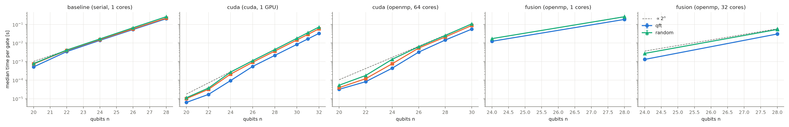
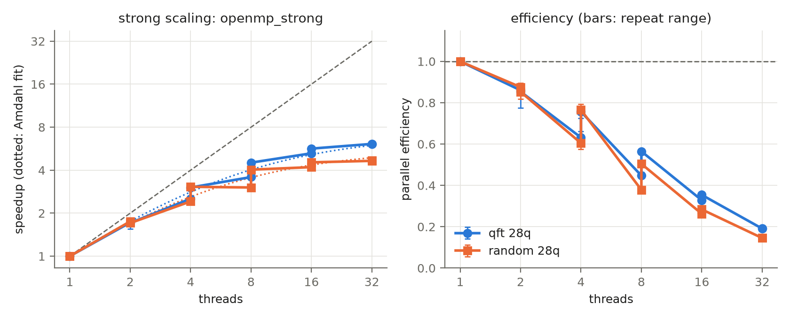
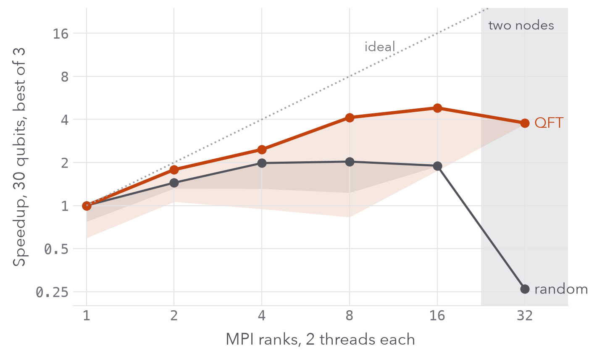
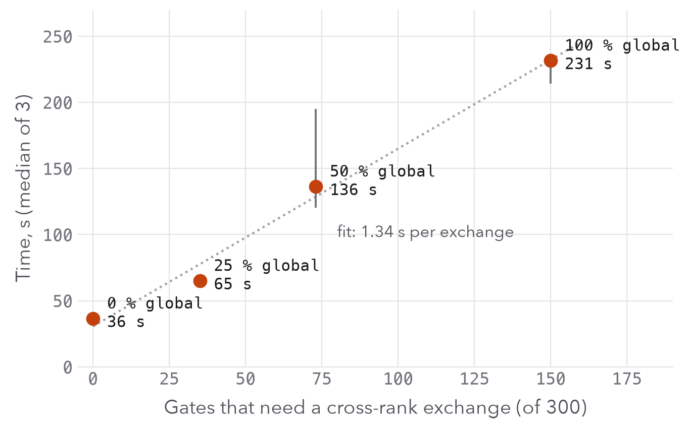

**Team:** Marija, Emma, Hurshneet, Edard, Ana-Maria · **Repository:** github.com/velkosska/Distributed-State-Vector-Quantum-Circuit-Simulator, branch `fusion-and-report` · **Code version of every result:** commit `fabbd99` (CUDA: `ead5cef`), clean tree, recorded in each job's `meta.txt` · **Reproduce:** `REPRODUCE.md`.

## 1. Problem and motivation

A quantum circuit on *n* qubits acts on 2ⁿ complex amplitudes. A state-vector simulator stores all of them (16 B each, double precision) and applies every gate as an update of the whole vector: a one-qubit gate mixes the 2ⁿ⁻¹ pairs of amplitudes whose indices differ only in the target bit. The method is exact and is how quantum algorithms are checked before they reach hardware, but its cost is exponential: 28 qubits need 4 GiB, 32 qubits 64 GiB, 40 qubits 16 TiB, and every extra qubit doubles both memory and time per gate.

Each gate does only 0.19–0.44 flop per byte it moves (Table 1), so we expected the simulator to be limited by memory bandwidth on one device and by network bandwidth once the state is split. Our question: **how far do OpenMP, MPI and CUDA get on this problem on SciTech, what limits each, and which optimisations remove passes over memory or exchanges over the network?** Success metrics: correctness against Qiskit to 10⁻¹⁰, time per gate, speedup and efficiency, achieved bandwidth.

## 2. Application architecture

One C++17 library with one binary per backend, built with CMake (`QSIM_OPENMP`, `QSIM_MPI`, `QSIM_CUDA`):

```
circuit file ─▶ read_circuit() ─▶ fuse() ─▶ backend ─▶ SUMMARY line + per-gate timing CSV
gen_circuits.py (QFT, Grover,      opt. 1     ├─ qsim       serial / OpenMP
random; seeded)                               ├─ qsim_mpi   2^p ranks, qubit remapping (opt. 2)
                                              └─ qsim_cuda  one kernel launch per gate
```

Every kernel is a loop over a pair index *k* with no dependencies between iterations, so the same code is the OpenMP loop (static schedule, cache-line-aligned tiles, matching first touch), the CUDA kernel (thread id = *k*) and the per-rank kernel of the MPI backend. With P = 2ᵖ ranks the top *p* qubits are *global*: diagonal gates and controlled gates with a global control need no communication; a dense gate on a global qubit exchanges the rank's slice with a partner in 64 MiB `MPI_Sendrecv` chunks. Qubit remapping swaps a global qubit with the local qubit used furthest in the future (Belady), so a run of gates on a global qubit costs one half-slice exchange. Benchmarks are QFT (structured, many controlled phases), Grover with one iteration (long Toffoli chains) and random depth-10 circuits, all with seed 1.

## 3. HPC implementation and technology matrix

| Technology | Tested | In final application | Main observation |
|---|---|---|---|
| Slurm (sbatch, srun, sacct, squeue) | Yes | Yes | every compute run; one harness writes `meta.txt` + `runs.csv` per job |
| OpenMP | Yes | Yes | 6.1× on 32 threads at 28 q; flattens with memory bandwidth |
| MPI (OpenMPI 4.1.5) | Yes | Yes | 4.8× on 16 ranks inside one node; slower once ranks span two nodes |
| MPI + OpenMP hybrid | Yes | Yes | 2 threads per rank in all MPI runs |
| CUDA 12.8 (extra technology) | Yes | Separate backend | 5.6–6.7× over 32 CPU cores from 26 q; capped at 32 q by 96 GB |
| Gate fusion (optimisation) | Yes | Yes (`--fusion 1q`) | 2.1–2.4× on random circuits, none on QFT |
| Qubit remapping (optimisation) | Yes | Yes (default on) | 1.7–9× less data per rank on test circuits |
| LIKWID / perf / Nsight Compute | Tried | No | not installed or no counter access (`perf_event_paranoid=4`, `ERR_NVGPUCTRPERM`) |
| Score-P 8.4 | Yes | No | MPI profile of the 30-qubit runs (Appendix A) |
| Qiskit (validation library) | Yes | Yes | reference state vectors, 2–20 qubits |

## 4. Experimental methodology

**Platform.** SciTech, partition `cpu`: nodes with 2 × AMD EPYC 9745/9755 (Zen 5, 2 × 128 cores), 503 GiB, 2 NUMA domains, 2 × 10 GbE bonded (20 Gb/s, no InfiniBand). GPU partition: NVIDIA RTX PRO 6000 Blackwell, 96 GB. GCC 12.3.0, OpenMPI 4.1.5, CMake 3.26.3, Python 3.11.3, `-O3 -march=native` (`env/modules.sh`, pinned Python packages in `env/requirements.lock`). The course QOS caps a user at **64 CPUs (32 physical cores)** and forbids `--exclusive`, so all CPU numbers describe one eighth of a node shared with other users' jobs.

**Runs.** Every run is a Slurm job through `slurm/lib/run_harness.sh`, which records the commit and dirty flag, binary SHA-256, modules, nodes, CPU model, `OMP_*`/`SLURM_*` variables, circuit generator command and hash, and the exact command line. The timer covers the gate loop only. Each configuration runs **3 times in the same job**; we report the median and the min–max range, except where stated. OpenMP runs use `OMP_PLACES=cores` with close and spread binding; MPI uses `srun --cpu-bind=cores --exact`. Weak scaling compares time per gate because gate counts grow with *n*. Speedup S = T(p₀)/T(p), efficiency E = S/p.

**Table 1. Traffic model (per amplitude of the state) used for bandwidth and arithmetic intensity.**

| Kernel | Gates | flop | bytes | flop/B |
|---|---|---:|---:|---:|
| dense 2×2 | H X Y RX RY U | 14 | 32 | 0.44 |
| diagonal | Z S T P RZ | 3–6 | 16–32 | 0.19 |
| controlled 2×2 | CX CY | 7 | 16 | 0.44 |
| controlled phase | CZ CP | 1.5 | 8 | 0.19 |

## 5. Results

**Correctness.** Serial, OpenMP (4 threads) and MPI (4 ranks) builds match Qiskit on all 168 circuits (QFT, Grover, random; 2–20 qubits), largest error 4.4 × 10⁻¹⁴ (jobs 36497–36499). The CUDA port passed the same 57-circuit check in the GPU team's run; that log is not yet committed (see §10).

**Serial baseline (job 36504, 45/45 runs).** Time per gate grows 4× per two qubits from 20 to 28 qubits (QFT: 0.52 ms → 205 ms), exactly with the state size (Figure 1). At 28 qubits a dense gate streams 8 GiB in 0.2 s, ≈ 40 GB/s, which equals the one-core STREAM triad measured on the same node (41 GB/s, job 36503).

{width=60%}

**OpenMP (jobs 36512, 36513).** Strong scaling at 28 qubits (Figure 2): QFT reaches **6.1×** on 32 threads (85 s → 14 s), random 4.6–5.0×. Spread binding beats close at 4–16 threads (3.0× vs 2.5× at 4) because it uses the memory channels of more core complexes; both meet at 32. An Amdahl fit gives f = 0.14 (QFT) and 0.18 (random), and the Karp–Flatt metric stays at 0.11–0.19 for all thread counts. The gate loop has no serial section, so this "serial fraction" is the share of time limited by shared memory bandwidth, visible already at 2 threads (1.7×). Weak scaling (24 q on 1 thread to 29 q on 32) keeps 89 % at 2 threads and 72 % at 4, then falls to **20 %** at 32: the threads share one memory system.

{width=78%}

**MPI strong scaling (jobs 36515, 36586, 36593).** 30 qubits (16 GiB), 2 threads per rank; 1–16 ranks fit in one node, 32 ranks span two. QFT reaches **4.8×** on 16 ranks (275 s → 57 s, best of 3) and drops to 3.8× at 32. Random circuits reach only 2.0× (8 ranks) and become **4× slower than one rank** at 32 ranks (1,397 s) (Figure 3). Repeats on the shared nodes varied up to 4×, so we show the best of three with the full range shaded; medians tell the same story with more noise (`results/summary/scaling_strong.csv`).

{width=60%}

**MPI weak scaling (jobs 36584, 36745, run by our teammates).** 4 GiB per rank, 28 qubits on 1 rank to 32 on 16, all on one node: QFT efficiency 92 % (2 ranks), 70 % (4), 37 % (8), **16 %** (16); random 68 % at 2 ranks and about 25 % at 8–16. The ranks share one node's memory bandwidth, and more ranks mean more global qubits and more exchanges.

**Sensitivity (job 36597, teammate run).** 30-qubit random circuits with 0–100 % of gate slots on the 4 global qubits, 16 ranks on two nodes, remapping off. Time grows **linearly with the number of exchanging gates**: 36 s with none, 231 s when all 150 dense gates exchange (Figure 4). The least-squares fit over all circuits gives 0.14 s per local gate and **1.41 s per exchanging gate**, a ratio of 10. Each exchange moves 1 GiB per rank.

{width=58%}

**CUDA (job 33869).** On one RTX PRO 6000 the GPU sustains 1,400–1,460 GB/s from 26 qubits and is **5.6–6.7× faster** than our 32-core OpenMP build, matching the bandwidth ratio (210–260 GB/s on the CPU side). It reaches 32 qubits (64 GiB); copies to and from the device take 9–34 % of GPU time for these short circuits.

## 6. Bottleneck analysis

**On a node: memory bandwidth.** Evidence: (1) every kernel has 0.19–0.44 flop/B, far left of the ridge point of any modern CPU; (2) serial time per gate scales exactly with bytes moved, and the achieved 40 GB/s equals one-core STREAM; (3) per-gate instrumentation (`results/summary/gate_bandwidth.csv`) shows all gate types at 105–116 GB/s on 32 threads, independent of their flop count, i.e. limited by bytes, not flops; (4) OpenMP strong and weak scaling flatten exactly where bandwidth saturates, and the GPU's advantage equals its bandwidth advantage. Our STREAM job used close binding and reached only 82 GB/s on 32 threads, below what the spread-bound gate kernels achieve, so we use it as the single-core roof only.

**Across nodes: the network.** We profiled the MPI runs with the backend's per-gate `MPI_Wtime` timers, which record time and bytes sent per gate (`analysis/comm_breakdown.py` → `results/summary/mpi_comm_breakdown.csv`):

| 30 q, best repeat | Ranks / nodes | Gate time | Exchanging gates | Share of time in exchanges | Effective GB/s per rank |
|---|---|---:|---:|---:|---:|
| Random | 16 / 1 | 174 s | 24 | 27 % | 0.27 |
| Random | 32 / 2 | 830 s | 29 | **95 %** | **0.01** |
| QFT | 16 / 1 | 51 s | 8 | 57 % | 0.15 |
| QFT | 32 / 2 | 57 s | 10 | 62 % | 0.07 |

Once ranks span two nodes, 29 exchanging gates take 95 % of the time and each rank sees about 10 MB/s, while the nodes have 20 Gb/s Ethernet shared by 16 ranks each. The sensitivity fit confirms it independently: one exchanging gate costs ten local gates. The SciTech interconnect (TCP over Ethernet, shared) is the bottleneck for anything that leaves a node, and the circuit's share of dense gates on global qubits decides how much it matters. A Score-P profile of the same runs is in Appendix A.

## 7. Optimisation

**Gate fusion (job 36514).** `fuse()` merges runs of single-qubit gates on a qubit into one 2×2 matrix, carries diagonal runs past controls, turns SWAPs into relabellings and drops identities; all backends use the fused gate list unchanged, and fused states match Qiskit to 10⁻¹⁰. Before/after, median of 3:

| Circuit | Gates | 1 thread: before → after | Speedup | 32 threads: before → after | Speedup |
|---|---|---|---:|---|---:|
| Random, 24 q | 298 → 143 | 5.15 s → 2.49 s | 2.07× | 0.82 s → 0.39 s | 2.13× |
| Random, 28 q | 349 → 158 | 95.0 s → 41.3 s | **2.30×** | 20.5 s → 8.5 s | **2.41×** |
| QFT, 28 q | 448 → 447 | 83.1 s → 84.0 s | 0.99× | 14.0 s → 13.7 s | 1.02× |

The speedup follows the removed passes over memory and holds at 1 and 32 threads, which confirms the bandwidth diagnosis. QFT gains nothing: it is almost all two-qubit controlled phases; two-qubit fusion would be the next step.

**Qubit remapping (MPI).** Remapping is on in all our MPI runs. Counted statically on 18-qubit test circuits with 4 ranks, it cuts the data sent per rank by 1.7–9× (e.g. random, 50 % global gates: 48 exchanges / 35 MiB → 5 swaps / 4 MiB). The sensitivity runs above were repeated with remapping on (job 36764); see Appendix A.

## 8. Technology exploration

CUDA was our additional technology. The port was a 1:1 mapping of the pair-index loop to one GPU thread per pair (≈ 220 lines); most effort went into the platform (CUDA as an Apptainer container without CMake, architecture detection for sm_120). It is the fastest backend by the bandwidth ratio, but a hard 32-qubit ceiling makes MPI the only route to larger states. We also tried hardware-counter profiling: LIKWID and perf are not available and PAPI/perf counters are blocked (`perf_event_paranoid = 4`), Nsight Compute needs counter permissions we do not have. These negative results are why our bottleneck analysis rests on instrumentation, STREAM and Score-P.

| | OpenMP (32 cores) | MPI (2 nodes) | CUDA (1 GPU) |
|---|---|---|---|
| Effort | lowest: one pragma per loop, pinning, first touch | highest: distribution, exchanges, remapping (≈ 470 lines) | low for kernels, moderate for tooling |
| Best measured | 6.1×, 105–116 GB/s per gate | 4.8× inside a node; network-bound across | 1,400–1,460 GB/s, 6.7× over 32 cores |
| Limit | one node's memory bandwidth | 20 Gb/s Ethernet, 10 MB/s per rank in practice | 96 GB: 32 qubits |

## 9. Conclusions

Bandwidth decides everything. On a node the simulator runs at the memory speed it is given (40 GB/s per core), so OpenMP buys 6.1× on 32 cores and the GPU buys another 6.7× because its memory is faster. MPI works well while ranks stay inside a node (4.8× on 16 ranks), but on SciTech's Ethernet an exchange costs as much as ten local gates and a run that spans two nodes can spend 95 % of its time communicating; the share of dense gates on global qubits, not the size, decides the cost. Gate fusion halves random circuits at no cost in accuracy; we measured it on the CPU, and because it only rewrites the gate list, every backend gets it. What did not work: hardware-counter profiling (no access), and multi-node strong scaling on this network. Next steps: overlap exchanges with computation (non-blocking `MPI_Isend/Irecv` per chunk), swap several global qubits per all-to-all, two-qubit fusion, and a run on a system with a real HPC interconnect, which is the scale-up plan below.

## 10. Reproducibility and known limitations

All commands are in `REPRODUCE.md`; module versions, compiler flags, seeds, Slurm requests and exact command lines are in each `results/<experiment>/<jobid>/meta.txt`, and selected job logs in `results/logs/`. Limitations: shared nodes (repeat ranges up to 4× for MPI; 25 configurations exceed a 10 % range and are flagged in `runs_summary.csv`); one eighth of a node per user; the MPI QFT job was preempted before 32 ranks and that point is a separate rerun on the same commit; the CUDA run predates later CPU kernel changes (GPU code unchanged, CPU side may be slightly slow) and its validation log is not yet in the repository; scaling sweeps omit Grover and stop at 32 qubits to fit the shared queue.

\newpage

# EuroHPC scale-up plan

**Goal.** Simulate 36–40 qubits (1–16 TiB), which no single SciTech node or GPU can hold, and measure weak scaling, strong scaling and communication cost on a real HPC interconnect. Our SciTech results show the code is bandwidth-bound on a node and network-bound across nodes; a larger system helps on both: more aggregate memory and memory bandwidth, and an interconnect 5–10× faster than 20 Gb/s Ethernet.

**Target system and access.** MareNostrum 5 GPP (BSC): 2 × Intel Xeon Platinum 8480+ (112 cores), 256 GiB DDR5 per node, InfiniBand NDR200 (we plan with 100 Gb/s ≈ 12.5 GB/s per node, the conservative reading of the shared-port configuration). Same x86 instruction set and Slurm/EasyBuild environment, so the harness and `env/modules.sh` carry over by changing module names. Alternative: LUMI-C (2 × EPYC 7763, 256 GiB, Slingshot-11). Access mode: **EuroHPC Benchmark Access** (scalability tests feeding a later Regular Access proposal).

**Memory.** State = 16 B × 2ⁿ; the MPI backend needs the slice plus an exchange buffer (64 MiB chunks, buffer factor 0.25). With ≈ 224 GiB usable per node, 32 qubits per node (64 GiB + 16 GiB buffer) leaves room for the OS and MPI:

| Qubits | State | Nodes (32 q per node) | Per node |
|---:|---:|---:|---:|
| 32 | 64 GiB | 1 | 80 GiB |
| 36 | 1 TiB | 16 | 80 GiB |
| 38 | 4 TiB | 64 | 80 GiB |
| 40 | 16 TiB | 256 | 80 GiB |

**Time per run, from our measurements.** A local gate streams the 64 GiB slice twice (read + write); at an assumed 400 GB/s STREAM per MN5 node that is ≈ 0.34 s (on SciTech we measured 105–116 GB/s on 32 cores). An exchanging gate also moves the slice over the network: 64 GiB / 12.5 GB/s ≈ 5.5 s, i.e. **≈ 16 local gates**. On SciTech we measured a ratio of 10 (1.41 s vs 0.14 s, job 36597), so the model is in the same range and probably pessimistic. Our random circuits have 8.5 % exchanging gates at 30 qubits on 16 ranks without remapping (`analyze_circuit.py`, job 36597), fewer with it; at 40 qubits (≈ 500 gates, 9 % exchanging): 455 × 0.34 s + 45 × 5.5 s ≈ 400 s ≈ **7 min on 256 nodes ≈ 30 node-hours per run**.

**Campaign and request.**

| Phase | Runs | Configuration | Node-hours |
|---|---|---|---:|
| Port, validation, STREAM and MPI ping-pong between 2 nodes | ~10 | 1–2 nodes | 10 |
| Weak scaling, QFT and random | 2 × 9 sizes × 3 | 32 q / 1 node → 40 q / 256 nodes (Σ 511 node-sizes × ≈ 0.1 h) | 310 |
| Strong scaling at 36 q | 2 × 5 × 3 | 16, 32, 64, 128, 256 nodes | 100 |
| Sensitivity at 36 q, remapping off and on | 4 × 2 × 3 | 16 nodes | 40 |
| Subtotal | | | 460 |
| × 1.5 for queue tests, failed runs and reruns of noisy points | | | **≈ 700** |

**Request: 800 node-hours** (≈ 90,000 core-hours) over three months. Week 1: port, validate against Qiskit, measure STREAM and inter-node bandwidth, and replace the model numbers above with measured ones. Weeks 2–4: weak scaling to 64 nodes with a go/no-go at **≥ 50 % weak efficiency** at 64 nodes (on SciTech we saw 16 % inside one shared node, so this is the key risk). Weeks 5–8: 256-node runs and strong scaling. Weeks 9–12: sensitivity and reserve.

**Software.** GCC 12+ or the system compiler, OpenMPI or the vendor MPI with UCX/InfiniBand, CMake ≥ 3.20, Python 3.11 with numpy/qiskit for validation; no licensed software. **Expected scaling challenges:** exchanges are blocking and one global qubit at a time (overlap and multi-qubit all-to-all swaps are the planned fixes); each extra qubit doubles the node count, so weak scaling is in powers of two only; network contention at 256 nodes is not captured by the model. **Support needed:** help choosing MPI/UCX transport settings, and access to Score-P/Scalasca or vendor tools with counter permissions on the compute nodes, which we lacked on SciTech.
